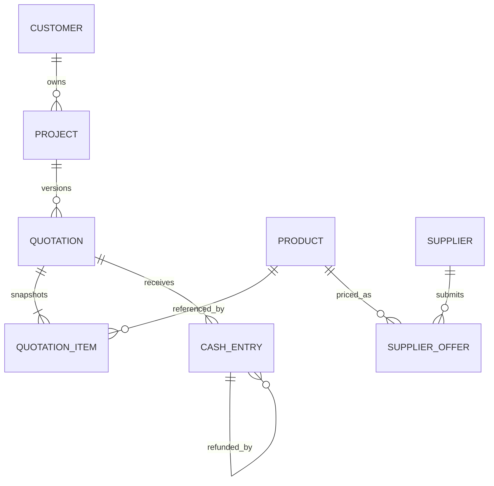

# 架构与开发约定

## 技术与边界

前端采用 Vue 3、TypeScript、Vite、Element Plus、Vue Router；后端采用 Java 17、Spring Boot、Spring Security、Bean Validation、Spring JDBC、Flyway。生产数据存放 PostgreSQL，本机使用 H2 的 PostgreSQL 兼容模式；兼容模式不能代替真实 PostgreSQL 验证。

本版服务一家企业的内部团队。客户是业务往来单位，不是可以登录的租户。未来若开放多企业 SaaS，需要增加组织、租户隔离和跨租户安全测试，不能仅增加一个前端筛选条件。

模块按业务划分，每个 HTTP 控制器委托模块服务。服务负责业务规则、权限和事务，公共 Database 封装参数化 JDBC 访问及审计。随着模块变复杂，应将查询拆为模块 Repository，并将返回对象从 Map 逐步收敛为明确的响应 DTO。当前输入均使用强类型 DTO 和校验约束。

## 业务关系

客户和供应商共用 partner 表，通过 kind 区分。产品以品牌、名称、规格、型号形成唯一组合。报价明细保存名称、规格、数量、单价和成本快照，不因产品资料变化而重算历史。

项目预留 external_id，空值表示尚未关联，非空时唯一；当前只维护标识，不会发出云智冷网络请求。真正对接时新增 integration/yunzhileng 适配模块，凭据由服务端环境或密钥服务提供，不放浏览器中。同步应包含人工核对、权限、重试、幂等键、上次同步时间和失败记录。

## 报价与应收

状态流转为 DRAFT → ISSUED → ACCEPTED；HISTORICAL 经人工核实可转 ACCEPTED。报价版本通过锁定项目行生成，数据库对项目与版本组合设置唯一约束。已保存报价不原地编辑，修改通过复制创建新版本。

每项目最多一份已确认订单，由 accepted_project 的唯一约束保证。接受新报价不能重复建立同项目应收。后续增补、变更订单和合同冲销应建立独立流程，不能直接改已入账明细。

应收 = 已确认订单金额 − 净回款。净回款 = 收款 − 退款。收款与退款锁定同一报价行，防止并发突破余额。流水不可编辑删除；退款必须关联原收款，累计退款不得超过原收款。凭证号唯一，重试重复凭证会拒绝再次入账。

## 金额与缺失值

金额使用 Java BigDecimal 和数据库 NUMERIC，不使用浮点数存账。数量保留 3 位小数、单价保留 6 位、金额保留 2 位；每行 HALF_UP 舍入再汇总。历史导入保存原行金额，不用已舍入的单价倒算覆盖原值。

缺失与真实 0 分开处理。任何明细缺成本时，整份报价的成本、利润及两种利润率不可用，已知金额可独立保留。总览利润只取完整报价；利润率按这些相同报价的合计利润除以合计销售金额计算。

当前税口径是报价级属性，录入人负责保证成本口径一致。若需要精确财务毛利，应升级为销售/采购分别设置税率、运杂费和可抵扣税额的模型，再新增计算版本，避免直接改旧数据语义。

## 权限、安全与审计

| 角色 | 内部资料查询 | 项目/基础资料/报价 | 回款/退款 | 用户/审计 |
|---|---|---|---|---|
| ADMIN | 是 | 是 | 是 | 是 |
| SALES | 是 | 是 | 否 | 否 |
| FINANCE | 是 | 否 | 是 | 否 |
| VIEWER | 是 | 否 | 否 | 否 |

全部角色都是公司内部人员，均可查询内部成本。未来客户门户必须单独建立权限和数据模型，不可直接使用 VIEWER。对客报价接口只返回销售数据；不依靠 CSS 隐藏内部成本。

采用服务端会话、HttpOnly / SameSite Cookie、CSRF 校验和 BCrypt 密码哈希。生产会话 Cookie 要求 HTTPS。Nginx 对登录限流；后端端口不公开。写入操作在业务事务中同时记录审计。审计查询限制最近 300 条，长期审计留存及不可篡改存储属于后续工作。

## 代码与变更规则

- 业务页面、表单和布局分离；组件通常不超过 250 行，样式独立存放。
- Java 使用模块内 Controller / Service 分工；复杂查询后续拆 Repository。新增外部接口走适配器，禁止直接从页面请求第三方密钥接口。
- 数据库变更新增 Flyway V2、V3 等迁移，已运行的历史迁移不回改。
- 业务规则先由服务端校验，前端仅承担交互提示；金额以服务端结果为准。
- 财务、状态机、权限和导入变化必须增加相应边界测试。纯文案、样式等低影响改动不机械增加测试。
- 依赖锁文件进入版本控制；定期评估补丁更新。发布前运行测试、前端构建和真实生产数据库验证。

当前列表由服务端返回当前企业记录、前端筛选分页。数据规模增长前应实现带索引的服务端分页、搜索和权限范围过滤；总览也应采用聚合查询，避免持续增长后在内存中统计全部历史。
